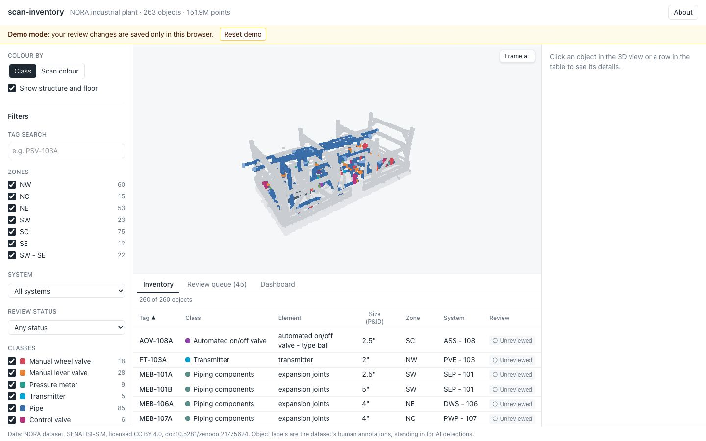
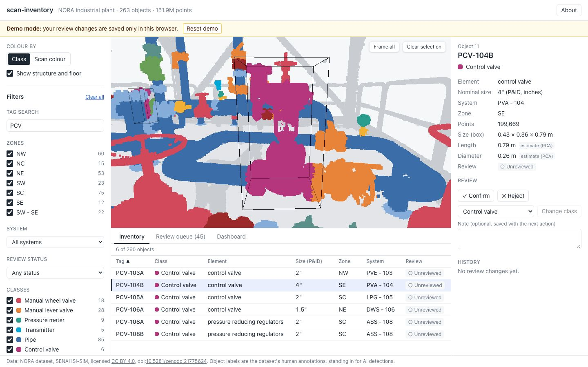
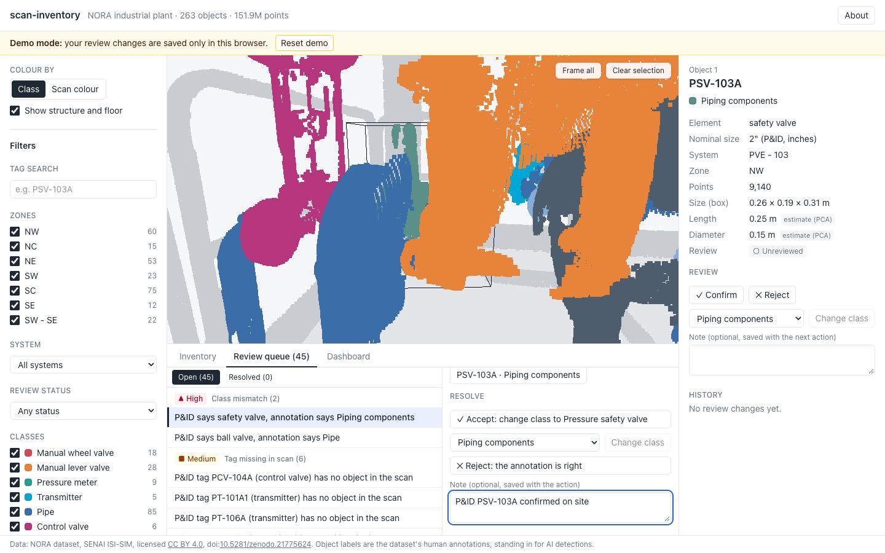
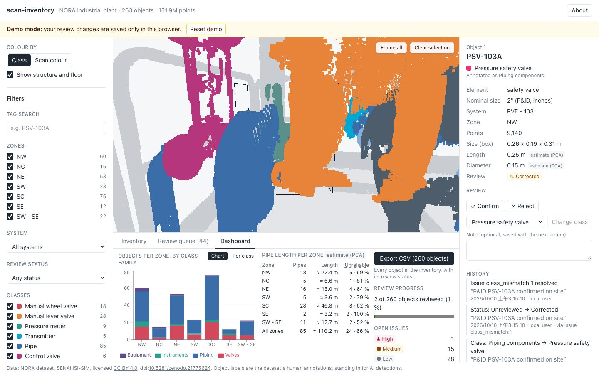
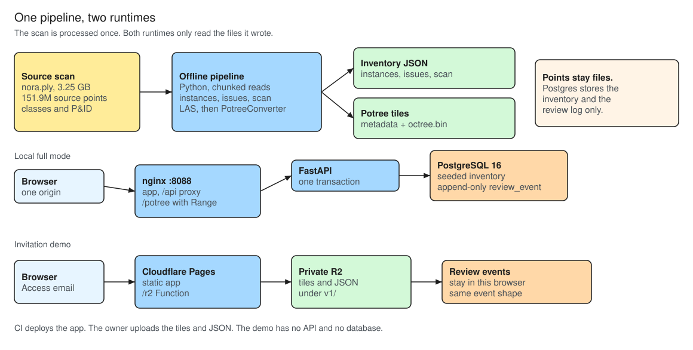

# scan-inventory

A web platform that turns an annotated laser scan of an industrial plant into a reviewable object inventory. You see the scan in 3D, get the list of objects (valves, flanges, pipes, instruments) by zone and system, linked to the P&ID tag list, and work through a review queue of suspicious results.

**Honest framing.** The objects come from the dataset's *human annotations*, which stand in for "AI detections". The review queue comes from rule-based checks against the P&ID. No model was trained here.

It shows three things:
1. **Large point clouds in the browser**: the source scan has 151.9 million points, streamed as Potree octree tiles. The loader selects at most 3 million points for a view.
2. **A product workflow around detections**: present, verify, correct, report.
3. **A clear architecture**: an offline pipeline, a typed API, persistence, containerised services, and one UI that runs against two interchangeable data sources.

The full specification is [docs/PRD.md](docs/PRD.md). Design records are in [docs/adr/](docs/adr/), and every task is explained in [docs/LEARNING.md](docs/LEARNING.md).

## Live demo

The demo is deployed at <https://scan-inventory.pages.dev>. It runs on Cloudflare Pages with a 13 % sample of the scan (about 20M points in the tiles). Cloudflare Access asks for an invited email before the page opens; the link is not public. In the demo, review changes are saved only in that browser. The owner's setup steps are in [docs/DEPLOY.md](docs/DEPLOY.md).

A video of the demo path (83 s) is recorded with `pnpm --dir web demo:record` and served with the demo data.



| an object, selected in the table | the review queue |
|---|---|
|  |  |



## What you can do

1. Open the scan. It streams in and is coloured by object class. Structure and floor can be shown in grey or hidden.
2. Filter the inventory by zone, system, class, review status or tag. The 3D view outlines the objects that match.
3. Click an object in 3D or in the table. The camera flies to it, and the detail panel shows its class, P&ID tag, element, nominal size, system, zone, point count and size.
4. Review it: confirm it, reject it, or change its class, with a note. Every change is kept in its history.
5. Work through the review queue: 45 issues, sorted by severity. For example, "P&ID says safety valve, annotation says Piping components".
6. See the dashboard: objects per zone and class family, estimated pipe length per zone (with the unreliable share), and review progress.
7. Export the inventory as CSV, including the review status.

## Architecture



The scan is processed once. Local full mode serves those files from nginx, with FastAPI and Postgres behind the same origin. The invitation demo serves the same kind of files from a private R2 bucket and keeps reviews in the browser. The view path, the review path, and the reason each split was chosen are in [docs/ARCHITECTURE.md](docs/ARCHITECTURE.md).

- **Heavy work offline, light work at runtime.** The 3.25 GB file is processed once. At runtime only pre-built tiles and small JSON files are served.
- **One interface, two data sources** ([ADR 0010](docs/adr/0010-data-sources-contract-and-panels.md)):
  - `ApiDataSource`: FastAPI and Postgres (local full mode).
  - `StaticDataSource`: the JSON files, with review changes kept in the browser (invitation demo).

  The same contract test suite runs against both.
- **One contract.** The API's OpenAPI schema generates the frontend's TypeScript types, and a test fails if they drift apart.
- **Loader and application.** `@pnext/three-loader` streams the octree, applies the point budget and `minNodePixelSize`, and reads the instance id with a GPU pick. This repository sets those parameters, the classification colour and the round points, moves the camera to a selection, and uses a bounding-box test when the pick misses. Inventory, review and the two data sources are application code.

### Technical decisions

| Decision | Why | Trade-off |
|---|---|---|
| Potree octree | Stream the scan instead of loading every point up front | Tiles are built offline with PotreeConverter |
| `@pnext/three-loader` | Classification colour works on these Potree 2.0 tiles | three.js stays on 0.160 ([ADR 0005](docs/adr/0005-potree-loader-and-picking.md)) |
| `minNodePixelSize` 50 | At the loader default of 200 px, a far view stayed on the root tile | More tiles per view ([ADR 0016](docs/adr/0016-point-detail-and-shape.md)) |
| Point budget 3M | Upper bound on points the loader selects for a view (`POINT_BUDGET` in `web/src/config.ts`) | Once the cap is reached, finer tiles are not added |
| PostgreSQL | Inventory and an append-only review history | Local full mode runs a database. The demo stores reviews in the browser ([ADR 0009](docs/adr/0009-api-data-model-and-tests.md)) |
| Two data sources | The same UI for the demo and local full mode | One extra interface, covered by one contract test suite ([ADR 0010](docs/adr/0010-data-sources-contract-and-panels.md)) |

| folder | what | tooling |
|---|---|---|
| `scripts/` | offline pipeline | uv, Python 3.12, numpy, plyfile, laspy |
| `api/` | FastAPI service | FastAPI, SQLAlchemy 2, Alembic, PostgreSQL 16 |
| `web/` | React app | React 18, TypeScript, Vite, Three.js 0.160, `@pnext/three-loader`, Zustand, TanStack Query, Recharts, Tailwind |
| `docs/` | spec, ADRs, learning log, runbook | |

## Design story: from data findings to architecture

Before designing anything, I measured the dataset ([PRD section 5](docs/PRD.md), [T2 spike report](docs/spikes/T2-report.md)). Each architecture decision answers one of those findings. Read each row left to right: what the data showed, what that rules out, what was chosen.

| finding (measured) | constraint | decision | record |
|---|---|---|---|
| One 3.25 GB file, 151.9M points | No browser can load it, and Python must not load it whole | Chunked offline pipeline (272 MB peak RAM on the full file) → Potree tiles with level of detail | [0004](docs/adr/0004-potreeconverter-native-macos-build.md), [0005](docs/adr/0005-potree-loader-and-picking.md) |
| Structure and floor are 74 % of all points | They swamp the equipment and the point budget | Shown in light grey with a toggle; class colours go to the equipment | [0007](docs/adr/0007-viewer-architecture.md) |
| Only 263 objects | The metadata is tiny | Filtering, the dashboard summary and CSV export run in the browser, the same code in both modes | [0010](docs/adr/0010-data-sources-contract-and-panels.md), [0013](docs/adr/0013-dashboard-and-export.md) |
| The P&ID and the annotations disagree | Results need a human check | Six rule functions → 45 issues → a review queue with an append-only audit history | [0002](docs/adr/0002-class-mapping-for-mismatch-rule.md), [0012](docs/adr/0012-review-queue.md) |
| 24 of 85 pipes are bent or branched | Their PCA length is not trustworthy (66 % of the length) | Labelled as an estimate, unreliable share shown, its own issue type | [0013](docs/adr/0013-dashboard-and-export.md) |
| Every point has an instance id below 65,536 | Clicking a point must return an object | The id goes into the standard LAS `point_source_id` field; a GPU pick reads it | [0005](docs/adr/0005-potree-loader-and-picking.md) |
| `octree.bin` is about 400 MB; Pages allows 25 MB per file | The static host cannot hold the tiles | Tiles in a private R2 bucket, read through a Function with HTTP Range | [0015](docs/adr/0015-demo-hosting-cloudflare.md) |
| The public demo may have no backend | Review state has nowhere to live | One `ScanDataSource` interface, two implementations, one contract test suite | [0010](docs/adr/0010-data-sources-contract-and-panels.md) |

In one sentence: big points go offline and into tiles, small metadata goes to the browser, and human decisions go into an append-only history.

Every ADR lists the options that were not chosen and what the chosen one costs. [docs/LEARNING.md](docs/LEARNING.md) explains each task in plain language, with quiz questions.

## Run it (macOS, Apple Silicon)

### 1. Tools

- [Docker Desktop](https://www.docker.com/products/docker-desktop/), running.
- [uv](https://docs.astral.sh/uv/).
- Node.js 22 and pnpm 10 (`corepack enable`).
- Build tools for PotreeConverter, which has no macOS binary ([ADR 0004](docs/adr/0004-potreeconverter-native-macos-build.md)):
  ```bash
  brew install gcc tbb cmake ninja
  ```

```bash
git clone https://github.com/shueny/scan-inventory.git   # private for now: ask the owner for access
cd scan-inventory
make install    # Python and Node dependencies, and Chromium for the browser tests
```

### 2. Data

Download the NORA dataset (SENAI ISI-SIM, CC BY 4.0, [doi:10.5281/zenodo.21775624](https://doi.org/10.5281/zenodo.21775624)) and put these files in place. They are never committed.

```
pointcloud/nora.ply
meta/classes.json
meta/pnid_composition.csv
```

### 3. Pipeline

Run from the repo root. Every step writes to `data/`, which is gitignored.

```bash
uv run --project scripts python scripts/build_instances.py   # data/instances.json, instances.csv
uv run --project scripts python scripts/build_issues.py      # data/issues.json (45 issues)
uv run --project scripts python scripts/build_scan_meta.py   # data/scan.json (classes, colours, zones)
```

Point cloud tiles. Build PotreeConverter once (about 20 s):

```bash
scripts/potree/build_converter.sh
```

Then pick one of the two tile sets:

- **The full scan:** a 5.1 GB LAS file, about 50 s to export, and 3.0 GB of tiles.
  ```bash
  uv run --project scripts python scripts/export_las.py --out data/las/nora.las
  scripts/build_potree.sh data/las/nora.las data/potree/nora
  ```
- **A 13 % sample:** 20M points, a 680 MB LAS file and 400 MB of tiles. Enough for development and the public demo ([ADR 0006](docs/adr/0006-demo-sampling.md)).
  ```bash
  uv run --project scripts python scripts/export_las.py --out data/las/nora-random13.las --sample 0.13
  scripts/build_potree.sh data/las/nora-random13.las data/potree/nora
  ```

The LAS file is only needed to build the tiles; you can delete it afterwards. Both commands write to `data/potree/nora`, so building one tile set replaces the other.

### 4. Start

```bash
cp .env.example .env
docker compose up --build
```

Open **http://localhost:8088**.

- The `api` container migrates the database and loads the pipeline's JSON once. Review decisions survive restarts.
- Ports can be changed in `.env` (`WEB_PORT`, `API_PORT`, `TILES_PORT`).

### Development

```bash
pnpm --dir web dev                       # http://localhost:5173, static mode (no API needed)
VITE_DATA_MODE=api pnpm --dir web dev    # api mode, uses the API from docker compose
```

In api mode the dev server passes `/api` to http://127.0.0.1:8000; if you changed `API_PORT`, set `API_PROXY_TARGET` to match.

Add `?stats` to the URL to see the frame rate and the points drawn.

## Quality gate

```bash
make gate
```

This runs:
- ruff, mypy and pytest for `scripts/` and `api/`. The API tests run on a throwaway Postgres (testcontainers), so Docker must be running.
- tsc, eslint, prettier and Vitest for `web/`.
- The data source contract tests against the real API.
- A Playwright smoke test of demo steps 3 to 9 (including clicking an object in 3D), on a small synthetic plant committed in `web/e2e/fixtures/`.
- The same smoke tests against the demo stack: the demo build under `wrangler pages dev` (the Cloudflare runtime), with the plant in a local R2 bucket.
- pre-commit.

CI runs the same steps on every pull request. The process is in [docs/RUNBOOK.md](docs/RUNBOOK.md).

## Performance

Measured on 2026-10-11 (round points, size 1.5) on a MacBook Air M3 (24 GB) with an external 144 Hz display. The browser was Chromium in a visible window (WebGL on Metal), with the dev server serving the full tiles (151.9M points) and a 3M point budget. The script is [`web/perf/measure-orbit.mjs`](web/perf/measure-orbit.mjs) (`pnpm --dir web perf`). For each view it orbits the camera for 6 s and records the time between frames.

| view | points in view (most) | median interval | 99th percentile interval | worst interval | frames over 33 ms |
|---|---|---|---|---|---|
| whole plant | 300k | 6.9 ms | 7.7 ms | 7.8 ms | 0 |
| mid zoom | 3.0M | 6.9 ms | 7.8 ms | 7.9 ms | 0 |
| close-up | 2.0M | 6.9 ms | 7.7 ms | 7.8 ms | 0 |
| very close | 2.5M | 6.9 ms | 7.8 ms | 7.9 ms | 0 |

- **Frame interval:** 6.9 ms is one refresh of that 144 Hz display. The script records `requestAnimationFrame` with vsync on, so the browser presents at most once per refresh. A steady interval at that period means those views kept up with the display. It is not GPU time. A frame that finishes early still waits for the next refresh, so the figure does not show spare capacity. The PRD target is 30 fps (33 ms per frame). No recorded frame reached it.
- **Detail:** the loader fetches a child tile only if its bounding sphere, projected on screen, has a radius of at least 50 device pixels ([ADR 0016](docs/adr/0016-point-detail-and-shape.md)). With the loader's default of 200 pixels (until 2026-10-11) the whole-plant view drew only the root tile, 13,105 points, and a closer view held at most about 373k; mid zoom now reaches the 3M budget.
- **Load time (demo: 13 % tiles, production build):** first points appear once the app (about 500 KB of gzipped JavaScript, budget 1 MB) and the first 0.3 MB of tile data (metadata, hierarchy, root tile) have arrived. With the production build on the 13 % demo tiles that took 0.2–0.3 s locally, 0.8 s at 20 Mbit/s and 2.2 s at 5 Mbit/s (2026-10-11, [spike](docs/spikes/T10-point-detail.md)). The rest of the first view then streams in: 26 tiles, about 4.4 MB.

## Known limitations

- **3D colours never change:** they come from the tiles, so a corrected object keeps its annotated colour in 3D. The table, the counts and the detail panel show the corrected class.
- **Filtering doesn't dim objects in 3D:** the loader cannot dim single objects, so the 3D view outlines the objects that pass instead ([ADR 0010](docs/adr/0010-data-sources-contract-and-panels.md)).
- **Pipe lengths are rough:** they are PCA estimates and wrong for bent or branched pipes. The dashboard shows the unreliable share.
- **Tag assignment and "tag missing" issues aren't linked:** assigning a P&ID tag does not close that tag's "missing" issue ([ADR 0012](docs/adr/0012-review-queue.md)).
- **The demo is invitation-only:** it runs behind Cloudflare Access. Every tile read is a Function request, and the free plan allows 100,000 a day ([ADR 0015](docs/adr/0015-demo-hosting-cloudflare.md)).
- **Desktop only:** mobile is out of scope.

## Data and licence

Data: NORA dataset, SENAI ISI-SIM, licensed [CC BY 4.0](https://creativecommons.org/licenses/by/4.0/), [doi:10.5281/zenodo.21775624](https://doi.org/10.5281/zenodo.21775624). The app shows this credit in its footer.
