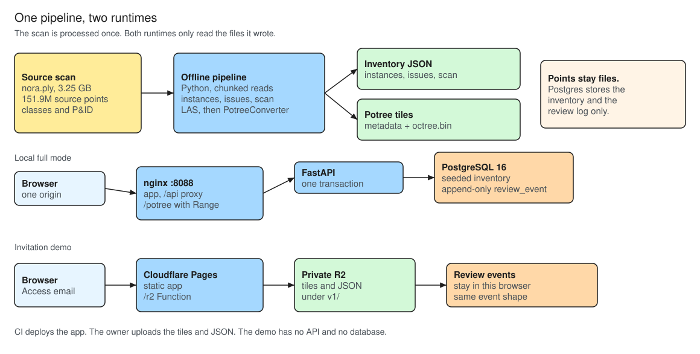
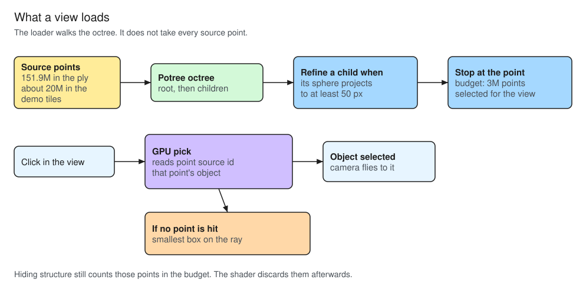
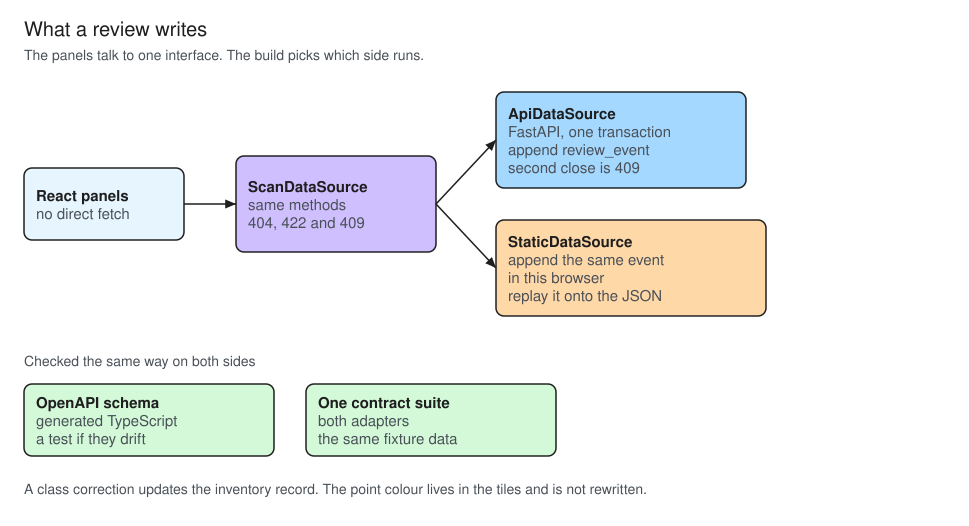

# Architecture

How the running system is split, and why each split was chosen. The pictures are also `.excalidraw` files in [docs/diagrams/](diagrams/); open those on [excalidraw.com](https://excalidraw.com). One script writes both formats ([ADR 0017](adr/0017-architecture-diagrams.md)): `node docs/diagrams/build.mjs`.

The records for the rejected options are in [docs/adr/](adr/).

## 1. One pipeline, two runtimes

The source file is 3.25 GB and 151.9 million points. Anything that touches it reads in chunks and runs once. After that, a runtime only serves the files the pipeline wrote: three small JSON files, and Potree tiles read with HTTP Range. The request path never opens `nora.ply`.

**Postgres does not store points.** It is seeded with the inventory and then stores the review log. The tiles stay files. Putting the cloud in the database would make every review, and every restart, pay for 151.9 million rows that the viewer does not query. ([ADR 0009](adr/0009-api-data-model-and-tests.md))

**Local full mode is one origin.** nginx on port 8088 serves the app, proxies `/api` to FastAPI, and serves `/potree` with Range. The browser never talks to the API port or a separate tile port. Three origins would need CORS on both the API and the tiles, and a build that knew those ports. ([ADR 0014](adr/0014-compose-web-service.md))

**The demo has no API and no database.** Cloudflare Pages serves the static build. `octree.bin` is one large file, and Pages will not host a file that size, so the tiles and JSON sit in R2. The bucket is private. A Pages Function at `/r2` checks the key and forwards the Range request. Cloudflare Access asks for an invited email before any of that runs. A public bucket, which was the first plan, would have let an uninvited client read the tiles. CI deploys the app. The owner uploads the files. ([ADR 0015](adr/0015-demo-hosting-cloudflare.md))

Both runtimes show the same UI. The build chooses the data source with `VITE_DATA_MODE`.

## 2. What a view loads

**An octree, not one buffer.** The root tile is a thin sample of the scan. A child is fetched only when its bounding sphere projects to at least `minNodePixelSize` device pixels. The walk also stops at `POINT_BUDGET`, 3 million points selected for that view. The browser never holds the source scan.

**50 px, not the loader default of 200.** At 200 px a far view stayed on the root tile (about 13k points of a 3 million budget) and the plant looked blocky. 50 px is the value that made equipment readable. The cost is more tiles per view, and on the demo that means more Function requests. ([ADR 0016](adr/0016-point-detail-and-shape.md))

**`@pnext/three-loader`, not `potree-core`.** Both load these Potree 2.0 tiles and both can pick. On this data, `potree-core`'s shader always takes the RGB attribute and ignores classification colour, which is the default view. three.js stays on 0.160 because that is the loader's peer dependency. ([ADR 0005](adr/0005-potree-loader-and-picking.md))

**GPU pick, then a box.** The pick reads `point source id` from the point under the cursor, so the object is the one that owns that point. Boxes overlap (a valve inside a pipe, anything inside the structural box), so the bounding-box test is only the fallback when the pick hits no point. The box comes from the inventory, which is why it can be drawn before that object's fine tiles have arrived.

**The demo tiles are a 13 % random sample, about 20 million points.** Every object is kept, and each object keeps a similar share, so the small parts are still there to see and to pick. A voxel sample was slower and kept an uneven share. The same 50 px rule and the same 3 million budget apply to the sample. ([ADR 0006](adr/0006-demo-sampling.md))

Hiding structure and floor does not drop those points from the budget. The loader has already selected them. The shader discards them.

## 3. What a review writes

**One interface, two implementations.** Panels and hooks call `ScanDataSource`. They do not call `fetch`. `ApiDataSource` talks to FastAPI. `StaticDataSource` reads the JSON and keeps the review log in the browser. The demo can then run with no server, and the UI code does not fork. ([ADR 0010](adr/0010-data-sources-contract-and-panels.md))

**A review is an appended event, not a rewritten row alone.** The API applies the change and appends `review_event` in one transaction. The actor stored today is the string `"local user"`. Closing an issue that is already closed returns 409. The demo appends an event with the same fields and replays the list onto the static JSON, so a refresh in that browser still shows the change. Storing only the current object would have dropped the history, and the demo would have needed a second model.

**The contract is checked, not assumed.** The OpenAPI schema is generated from the FastAPI app and committed. `openapi-typescript` turns it into the frontend types, and a test fails if the two files drift. One contract suite runs against both data sources on the same fixture data. A mock of the API would have tested the mock.

**Lists, the dashboard and the CSV are computed in the browser.** There are 263 objects. One set of functions in `web/src/domain/` does the work for both modes, so the API has no summary or export route. ([PRD §6.1](PRD.md)) Families, zone counting and the CSV columns are [ADR 0013](adr/0013-dashboard-and-export.md).

A class correction updates the inventory record the panels read. The colour in the 3D view is the classification written into the tiles when they were built. The tiles are not rewritten.

## Where the code lives

| Folder | Role |
|---|---|
| `scripts/` | The offline pipeline. Its own lockfile. |
| `api/` | FastAPI, SQLAlchemy, Alembic. Its own lockfile. |
| `web/` | React, the viewer, both data sources. |
| `docs/adr/` | The options that were turned down. |

`scripts/` and `api/` are not one Python package. They depend on different things and ship in different images. A shared lockfile would have coupled a pipeline change to the API image. ([ADR 0001](adr/0001-repo-layout-and-tooling.md))
