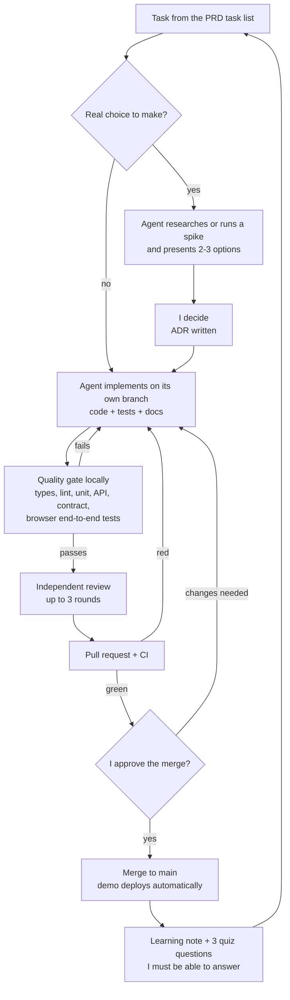
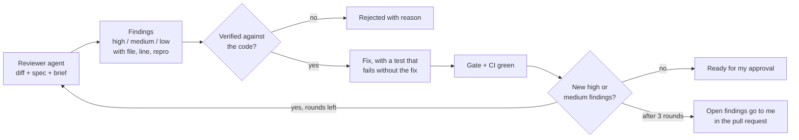

# How scan-inventory was built: AI-assisted development with clear ownership

Shueny Wang · October 2026

I built scan-inventory with Claude Code as a coding agent. I wanted to find out how far one person can go with an AI agent while staying in charge of every product and engineering decision, and while still being able to explain every part of the system. This page describes the process and the safeguards I put around the agent.

## Who does what

| | Me (owner) | Coding agent | Automation |
|---|---|---|---|
| Scope | Writes the product spec (PRD) and the task list | Reads the spec before each task | |
| Decisions | Chooses between options; accepts or rejects each ADR | Researches, measures, proposes 2 or 3 options with a recommendation | |
| Code | Reviews diffs; asks for changes | Writes code, tests and docs on one branch per task | |
| Verification | Checks the result in a real browser | Runs the gate locally, fixes failures | CI runs the full gate on every pull request |
| Review | Reads the findings; decides on open ones | A separate reviewer agent, without the conversation, reviews each change | |
| Release | Approves every merge | Merges only when asked | The demo deploys automatically from `main` |
| Learning | Answers the quiz questions | Writes a learning note per task | |

## The loop for each task

The rules behind this loop are written in the repository's `CLAUDE.md`, which the agent reads at the start of every session:

1. **One task at a time.** The tasks in the spec are done in order, one branch and one pull request each. The next task starts only after I approve the current one.
2. **Decisions belong to the owner.** For any real choice (library, data model, algorithm, hosting) the agent presents options with trade-offs and a recommendation, then waits.
3. **An ADR for every decision**: context, options, decision, consequences.
4. **No silent scope growth.** Useful extras are proposed, not added.
5. **A quality gate before "done"**, with the command output as proof.
6. **Explain after each task**: what was built, the key concepts, why it was done this way, and three quiz questions.

## The independent review

The agent that wrote a change does not judge it. Before every merge, a fresh reviewer agent gets only the diff, the task's spec, the project rules and the relevant ADRs, plus a written brief. It has not seen the conversation that produced the code.

The brief asks for bugs and edge cases, behaviour that differs between the two data modes, requirements that are missing, tests that would pass even if the code were wrong, accessibility problems, and rule violations. Every round is recorded in the pull request.

## Examples from the project

- **A misleading test.** In the first review of the test harness, the reviewer found that the browser smoke test still passed with a broken point cloud. The test now requires loaded tiles in view.
- **A process bug.** A later round found that a review round had been logged as done before CI was green, and CI could not even start. The rule changed: a round closes only when CI on the pushed fix is green.
- **A real defect.** In the review queue task, the reviewer found that "Change class" started on the wrong class. It was fixed with a test that failed before the fix.
- **Evidence instead of guesses.** When I found the live demo blurry, the agent traced the cause to the loader's level-of-detail threshold. It measured four settings (points drawn, download size, frame rate) and showed screenshots side by side. I chose the trade-off and it went into ADR 0016. When I then saw white specks up close, the same method led to a point-size change.
- **Things only a human saw.** The blurriness and the specks were not caught by any test; I saw them in the browser. Automated checks prove that things work; looking at the product still matters.

## The project in numbers

- 11 tasks (T0 to T10), 14 merged pull requests, 16 ADRs.
- 267 tests on every pull request: 52 pipeline, 47 API, 132 web unit, 15 contract, 9 browser end-to-end, and 12 end-to-end on the demo hosting stack.
- Performance measured with a script: 144 fps with up to 3 million points drawn (MacBook Air M3, full 151.9 million point scan).
- 13 learning notes (one per task and follow-up) with 39 quiz questions.

## What I learned

- AI lets one person work at a much larger scope, but it only produces reliable software inside a clear structure: an explicit spec, human decisions, automated verification and independent review.
- Writing the rules down (`CLAUDE.md`, the review brief, the runbook) matters more than any single prompt. The rules survive across sessions; prompts do not.
- Asking the agent for options and measurements, instead of answers, keeps me in the decision and makes the decision explainable later.
- The weakest link is verification, not code generation. Most of the effort went into tests, review and measurement.

This is how I would like to work with AI in a team: as an accelerator inside a disciplined engineering process, not as a replacement for judgement.
