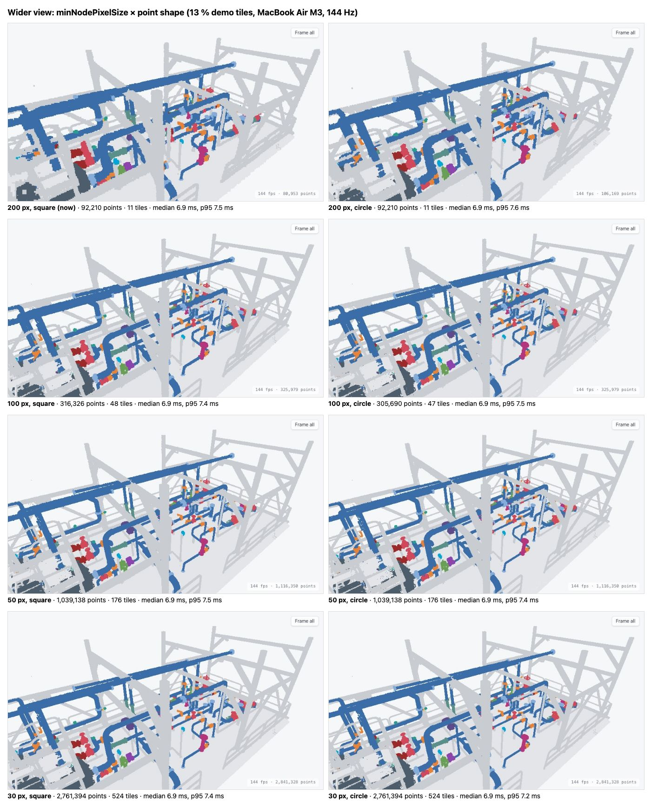
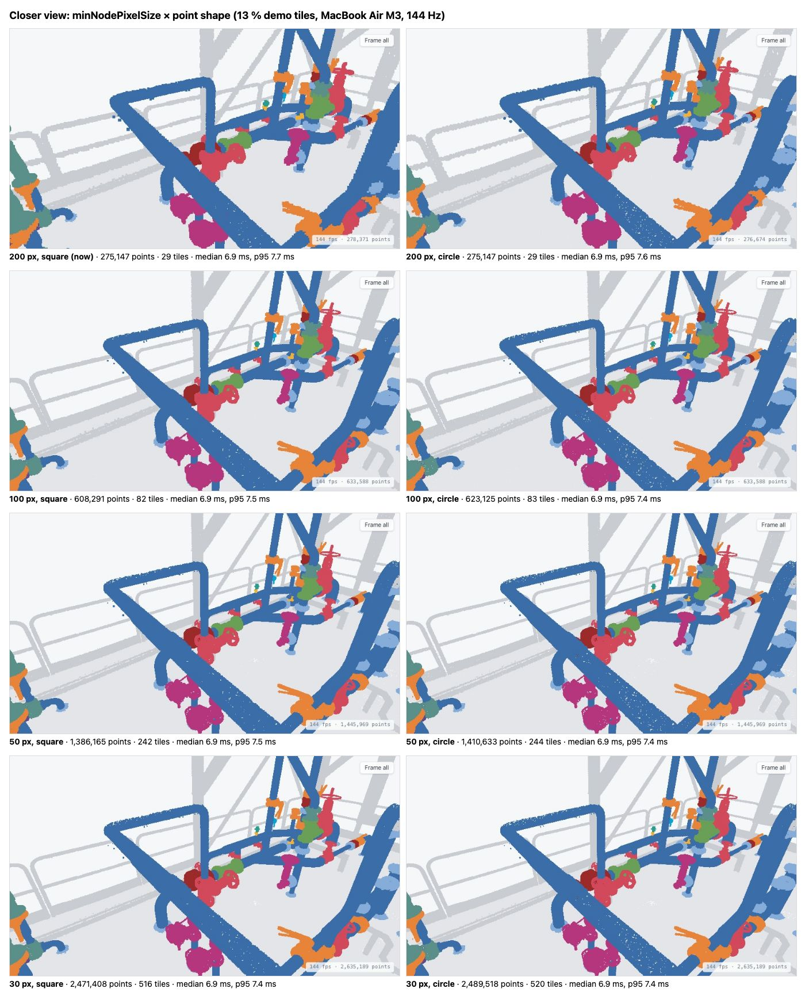

# T10 spike: why the demo looked coarse, and how much detail to stream

Date: 2026-10-11. Owner's question: "the demo looks blurry; how can it look sharper?" Decision in [ADR 0016](../adr/0016-point-detail-and-shape.md).

## What was wrong

The loader (`@pnext/three-loader`) streams an octree. It only fetches a tile's finer children once that tile covers at least `minNodePixelSize` pixels on screen. The app never set this, so it used the loader's default, **200 px**. In a view of the whole plant no child tile reaches 200 px, so the loader drew only the coarsest tile:

- in the browser pane (1440 × 900 page, 1× pixel ratio), 13,105 points: the root tile alone, from a point budget of 3,000,000;
- on the MacBook Air's Retina screen (2×), 92,210 points in 11 tiles.

Each point was then drawn large, to cover the gaps, and square, so the edges looked blocky. The point shape was a smaller part of the problem.

## How it was measured

A throwaway Playwright script ran on the demo's 13 % tiles (`data/potree/nora-random13`, served by `vite dev`), in a visible Chromium window so the real GPU was used. It used the `?e2e` hook to change `minNodePixelSize` and the point shape on the running viewer. For two fixed camera views, each setting was given 9 s to stream, then the view was captured and the camera orbited for 4 s while frame times were recorded (vsync on, 144 Hz display).

## Results (13 % demo tiles, MacBook Air M3)

| `minNodePixelSize` | wider view: points / tiles | closer view: points / tiles | tile data per view | frame time (median / p95) |
|---|---|---|---|---|
| 200 (loader default) | 92,210 / 11 | 275,147 / 29 | about 2–6 MB | 6.9 / 7.5–7.7 ms |
| 100 | 316,326 / 48 | 608,291 / 82 | about 7–13 MB | 6.9 / 7.4–7.5 ms |
| **50 (chosen)** | 1,039,138 / 176 | 1,386,165 / 242 | about 22–29 MB | 6.9 / 7.4–7.5 ms |
| 30 | 2,761,394 / 524 | 2,471,408 / 516 | about 52–58 MB | 6.9 / 7.2–7.4 ms |

- Tile data is points × 21 bytes (`octree.bin` is 414,688,617 bytes for 19,747,077 points).
- Each tile is one ranged request, which on the demo is one Pages Function request (free plan: 100,000 a day).
- Square and circle points gave the same point counts and frame times. Circles have cleaner edges at 200 and 100 px; at 50 px and below the two look almost the same.
- Every setting held 144 Hz. The cost of more detail is download size and Function requests, not frame rate.

## After the change (in the app)

The whole-plant view in the browser pane (1440 × 900, 1×) went from 13,105 points (1 tile) to 209,427 points (26 tiles, 3 levels).
