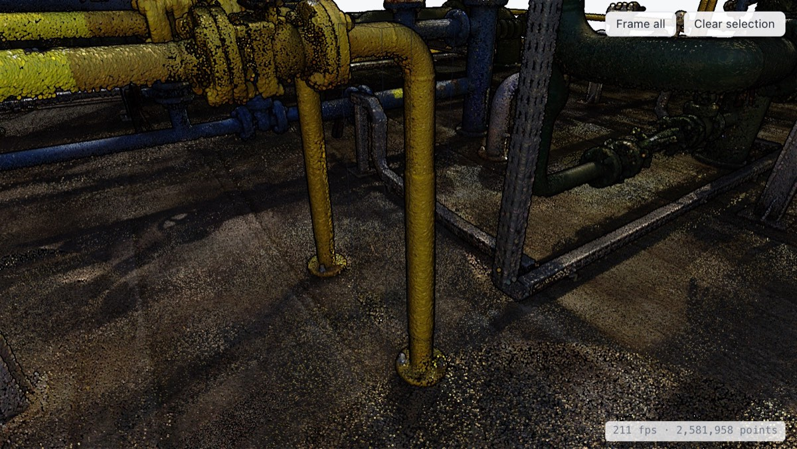
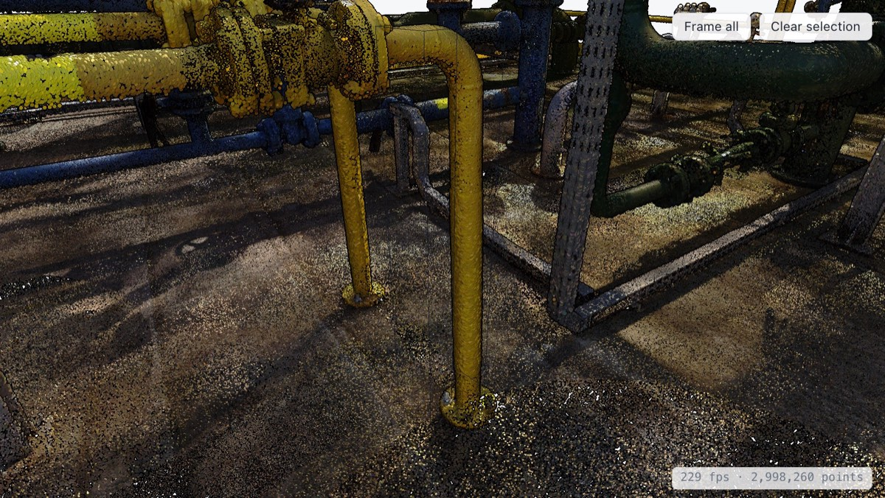
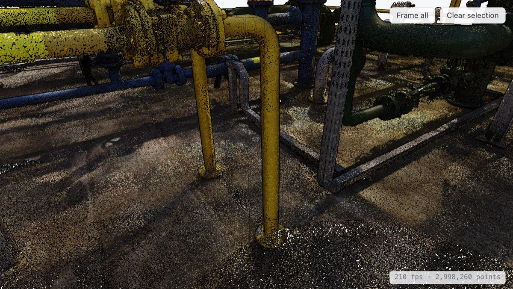
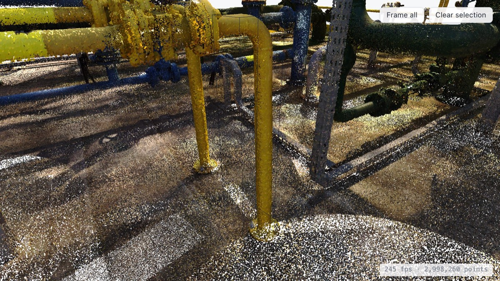
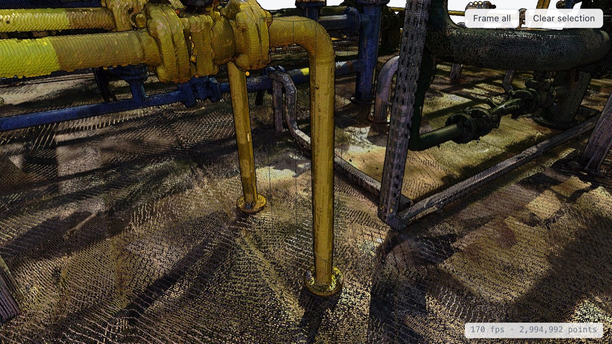

# T12 spike: point size, EDL strength, point shape and sampling

Date: 2026-11-16. Owner's question: "how can the cloud look finer, more like a real 3D model, at the same performance?" Decision in the amendments to [ADR 0019](../adr/0019-point-shading-edl.md) and [ADR 0016](../adr/0016-point-detail-and-shape.md).

## How it was measured

A throwaway Playwright script, in a visible Chromium window so the real GPU was used (ANGLE Metal, Apple M3). Vsync and the frame rate limit were off (`--disable-gpu-vsync --disable-frame-rate-limit`), so the frame interval shows the render cost instead of the 144 Hz refresh. Window 1440 × 900 at a 2× pixel ratio, scan colour, EDL on.

It used the `?e2e` hook to change the point size and shape on the running viewer, and the EDL strength and radius on the pass. Two fixed views: a close-up of the floor and two pipes (instance 100), and gate valve VGF-106A. Each setting got 1.5 s, then 3 s of frames from a still camera.

Two tile sets with the same `vite dev` app: the demo's 13 % random sample (`nora-random13`) and the 5 mm voxel sample from T2 (`nora-voxel5mm`, built with `scripts/build_potree.sh` in 6 s, 18.1M points, 363 MB `octree.bin`).

## Results (frame interval, median / p95, ms)

| setting | random 13 %, close-up | random 13 %, valve | voxel 5 mm, close-up | voxel 5 mm, valve |
|---|---|---|---|---|
| A: size 1.5, EDL 1.0 / 1.4 px (before) | 4.7 / 9.4 | 2.4 / 3.8 | 3.7 / 4.9 | 2.7 / 4.6 |
| B: size 1.0, EDL 0.6 / 1.0 px | 4.4 / 7.4 | 2.3 / 4.0 | 4.1 / 6.6 | 2.5 / 3.7 |
| **C: size 1.25, EDL 0.6 / 1.0 px (chosen)** | 4.2 / 7.2 | 2.3 / 3.9 | 4.1 / 7.5 | 2.6 / 3.7 |
| D: as C, paraboloid points | 6.8 / 8.0 | 3.2 / 4.7 | 7.4 / 11.0 | 3.5 / 4.7 |
| E: as C, EDL off | 4.2 / 6.0 | 2.6 / 5.6 | 4.5 / 7.0 | 2.5 / 3.6 |

The close-up drew about 3.0M points (the point budget), the valve view 1.3–1.4M. A 144 Hz display allows 6.9 ms per frame.

- **A, B, C and E cost the same.** The differences are within run-to-run noise.
- **Paraboloid points (D) cost 40–80 % more** and look almost the same as C. They write depth per pixel, which turns off the GPU's early depth test.

## What the pictures show (random 13 %, close-up)

**A, before:** a thick dark rim around the pipes and on the floor.

**C, chosen:** thinner outlines, cleaner pipe colour, the same frame time.

**B, size 1.0:** the gaps between points return as dark specks.

**E, EDL off:** the floor fills with white specks. On the 13 % sample EDL is also hiding the gaps between points, not only drawing outlines.

**Voxel 5 mm, setting C:** sharper silhouettes and more points on small parts, but floors and pipe walls show a regular grid pattern from the voxel cubes.

**D, paraboloid:** close to C by eye.

## Decision

Setting C: point size 1.25, EDL strength 0.6 and radius 1.0 px. The demo keeps the 13 % random sample ([ADR 0006](../adr/0006-demo-sampling.md)); the voxel grid pattern is not closer to a real surface. Paraboloid points are not used.

The real limit is density. The full tiles (151.9M points) are the larger step, and they need the source scan back on this machine.
