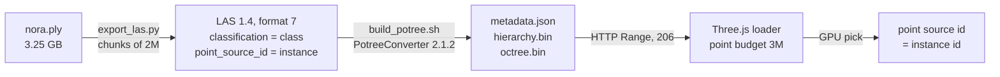
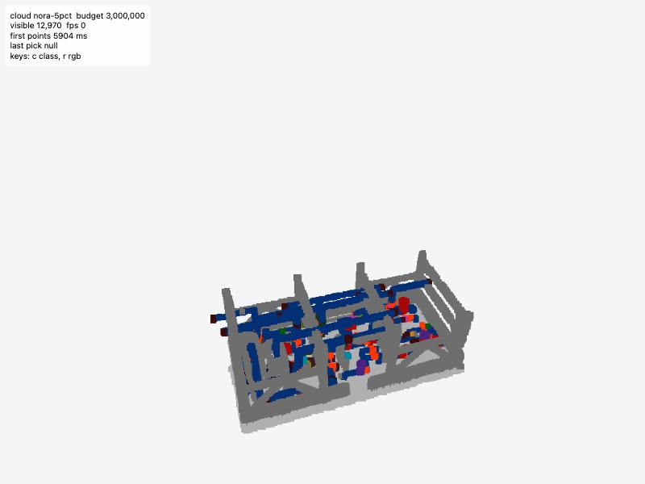
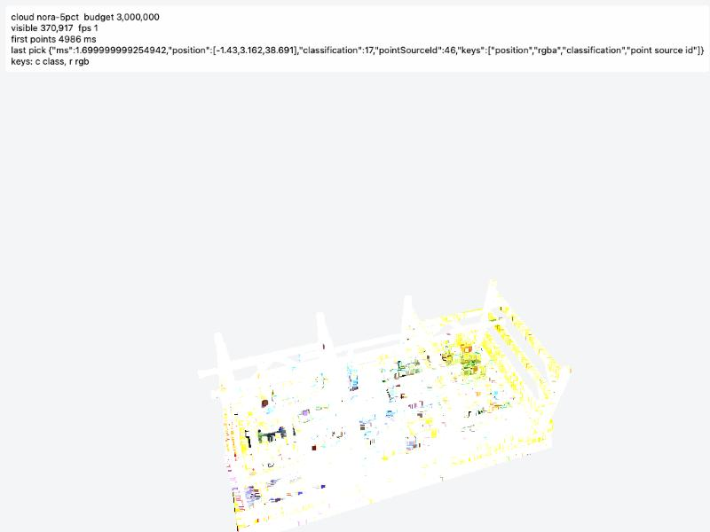
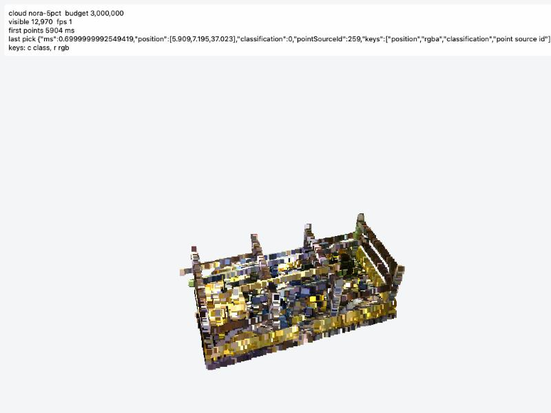
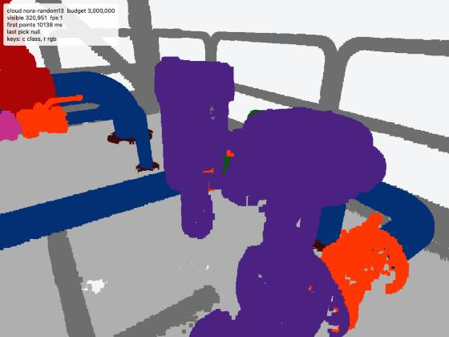
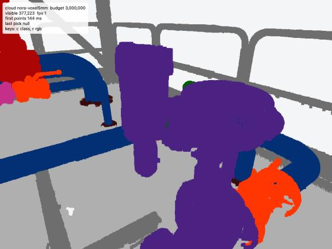
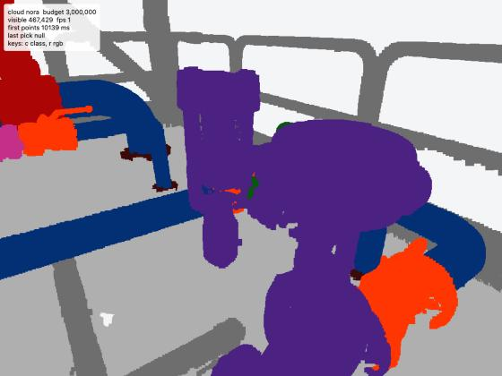

# T2 spike report: LAS export, PotreeConverter, loader

2026-10-09 · branch `t2-spike` · decision gate: the owner chooses before T3 starts.

## Answers

| question | answer | evidence |
|---|---|---|
| (a) does `point_source_id` survive conversion? | **Yes.** | `scripts/verify_potree.py` decodes `octree.bin` directly. Per-instance point counts and all 263 (instance, class) pairs are identical to the LAS, for the 5 % sample and the full 151.9M points. |
| (b) can the loader read classification and point_source_id at a picked point? | **Yes, both candidates.** | GPU pick returns `classification` and `point source id`. 6 picks checked against `instances.json`: class matches and the picked position lies inside that instance's box. ~1–2 ms per pick. |
| (c) can it colour by classification? | **Only `@pnext/three-loader`.** | `potree-core` ignores the colour mode for Potree 2.0 data. Its RGB is also wrong by default (sRGB bug), but that one can be fixed with `material.outputColorEncoding = 1`; class colouring cannot. |
| (d) tile size and load time | see tables below | First screen needs ~0.3 MB for every variant. |
| (e) recommended loader and picking | `@pnext/three-loader` 1.0.0 + GPU pick on `point source id` | ADR 0005 |

## How the pipeline runs



## PotreeConverter on Apple Silicon

No macOS binary exists, the source only supports Linux and Windows, and 2.1.3+ uses a Windows-only call. Docker Desktop did not start on this machine without user interaction. Built tag **2.1.2** natively with Homebrew GCC 14 + TBB and a 120-line patch that only adds `__APPLE__` branches. Details and alternatives: ADR 0004.

```
scripts/potree/build_converter.sh   # once
scripts/build_potree.sh data/las/nora.las data/potree/nora
```

## Numbers

Pipeline (`export_las.py`, chunked; memory = peak footprint of the Python process):

| output | points | LAS | export time | memory |
|---|---|---|---|---|
| full | 151,901,442 | 5.1 GB | 47 s | 272 MB |
| random 13 % | 19,747,077 | 678 MB | 24 s | 220 MB |
| voxel 5 mm | 18,105,623 | 636 MB | 498 s | not measured (RSS 2.7 GB incl. mapped file) |
| random 5 % | 7,600,555 | 261 MB | 31 s | — |

PotreeConverter (`--attributes rgb classification "point source id"`, 21 bytes per point):

| tiles | `octree.bin` | `hierarchy.bin` | octree depth | convert time |
|---|---|---|---|---|
| full | 3.0 GB | 1.7 MB | 13 | 25 s |
| random 13 % | 399 MB | — | 10 | 4 s |
| voxel 5 mm | 368 MB | — | 7 | 3 s |
| random 5 % | 152 MB | 68 KB | 8 | 2 s |

Load (local Vite dev server, resource timing in the browser):

- First screen = `metadata.json` (2.6 KB) + `hierarchy.bin` first chunk (13 KB) + root node (~275 KB) ≈ **0.3 MB** for every variant, done 68 ms after page start locally. At 20 Mbit/s that is about 0.15 s plus latency, well inside the 5 s target. Rest streams by camera position.
- Every `octree.bin` request was answered `206 Partial Content`.
- A close-up view with the 3M budget pulled ~6–8 MB in ~50 Range requests.

**Determinism** (PRD section 10): `export_las.py` output is byte-identical across runs (checked with `cmp`). PotreeConverter is multi-threaded, so two conversions of the same LAS give tiles with the same points per instance but a different node order in `octree.bin` and `hierarchy.bin`. Content is reproducible, bytes are not. Fine for us: tiles are built once per version and uploaded under a versioned path (PRD 6.2).

**Not measured yet:** frame rate and wall-clock time to a fully refined view. The browser pane was hidden during the spike, so the browser throttled rendering to ~1 frame per second; those numbers would be wrong. To be measured in T3 in a visible window on the MacBook Air (PRD 8.3).

## Loaders compared

| | `@pnext/three-loader` 1.0.0 | `potree-core` 2.0.15 |
|---|---|---|
| loads our tiles | yes, with `new Potree("v2")` | yes |
| class colours |  correct |  wrong: white/yellow in both modes |
| RGB |  correct | wrong by default (same image); correct with `material.outputColorEncoding = 1` |
| pick | correct ids | correct ids |
| three.js | `~0.160.0` | `>0.125` |

Root cause for `potree-core`: in the Potree 2.0 shader path `vColor = rgba` is used regardless of colour mode, and `fromLinear()` passes `mix()` arguments in the wrong order, so most colours are multiplied by 12.92.

## Sampling compared

Same close-up of pressure meter 10 (1,854 points in the full scan; green, behind the purple control valve), 3M budget:

| random 13 % | voxel 5 mm | full |
|---|---|---|
|  |  |  |

No object was lost by either method. Smallest objects keep 143 (random) vs 371 (voxel) points. Recommendation and trade-offs: ADR 0006.

## Decisions (accepted by the owner, 2026-10-09)

1. Loader: `@pnext/three-loader` 1.0.0 (pins three.js 0.160) — ADR 0005.
2. Picking: GPU pick on `point source id`, bounding-box test only as fallback — ADR 0005.
3. Demo sampling: random 13 % — ADR 0006.
4. PotreeConverter: native 2.1.2 + patch — ADR 0004.

The throwaway viewer pages lived outside the repo and were deleted after the decision.

An independent verification of this report is in `T2-verification.md`.
